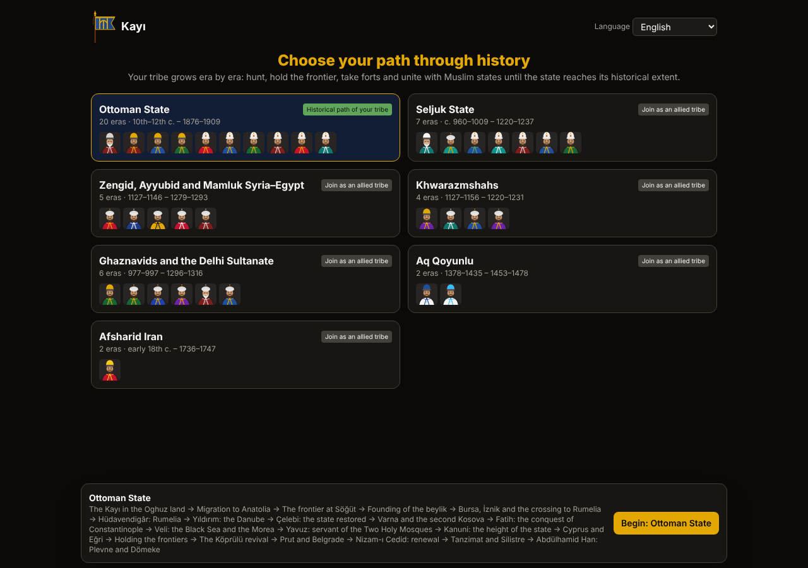
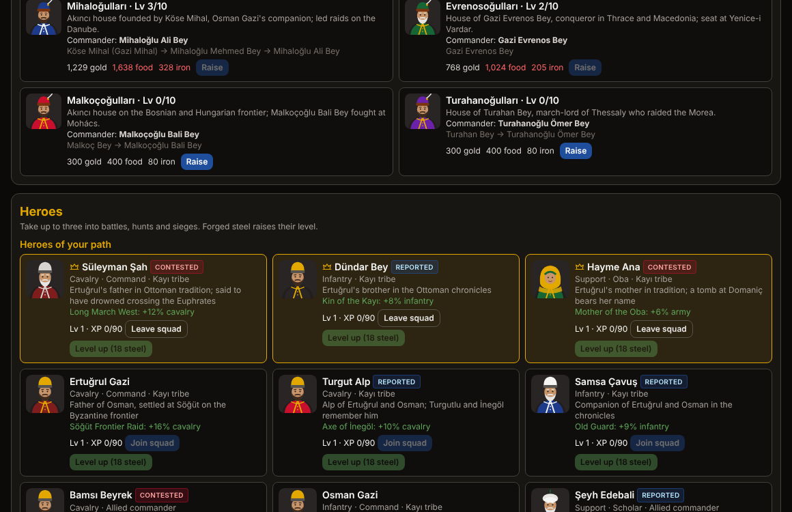

# Rise of Oghuz Sons

**A strategy and conquest game on the 24 Oghuz tribes and the Turkic and Muslim states of history, playable in ten languages.**

Lead one of the 24 tribes descended, in the Oghuz Khagan tradition, from his six sons, and live through the history
of a state era by era. The Kayı path runs through 20 eras, from the Kayı in the Oghuz land, Süleyman Şah and
Ertuğrul Gazi to Osman Gazi, Orhan, Murad Hüdavendigâr, Fatih, Yavuz, Kanuni and Sultan Abdülhamid Han. The army
changes with the eras (Alp, Akıncı, Yaya and Müsellem, Yeniçeri, Tımarlı Sipahi, Topçu, Nizam-ı Cedid, Asakir-i
Nizamiye), and so does the banner over your forts: the tuğ, the red sancak attested from Orhan's reign, the red
flag with a white crescent of 1793 and the crescent and star of 1844. Each era has its ruler, the companions
remembered with him and its frontier forts. Six more paths cover the Seljuks, Zengid–Ayyubid–Mamluk Syria and Egypt,
the Khwarazmshahs, the Ghaznavids and the Delhi Sultanate, the Aq Qoyunlu and the Afsharids. In all there are
122 heroes, 86 historical forts and battles and the four akıncı houses: Mihaloğulları, Evrenosoğulları,
Malkoçoğulları and Turahanoğulları.



| Kanuni's era: forts flying the Kayı banner | Akıncı houses and heroes of the path |
|---|---|
|  |  |

## Play

- **Online:** after the first push, GitHub Pages publishes the game at
  `https://mhkhan50.github.io/Rise-Of-Oghuz-Sons/` (Settings → Pages → Source: *GitHub Actions*).
- **Locally:**

```bash
npm install
npm run dev      # development server
npm run build    # type-check and production build into dist/
```

Progress is saved in the browser. Food, wood, stone and iron keep accumulating while the game is closed, for up to
eight hours.

## Languages

English, Roman Urdu, Türkçe, Azərbaycanca, Türkmençe, Gagauzca, Oʻzbekcha, Қазақша, العربية and فارسی, with
right-to-left layout for Arabic and Persian. The interface is fully translated in English, Roman Urdu, Turkish,
Azerbaijani, Turkmen, Arabic and Persian; Gagauz, Uzbek and Kazakh cover the main controls and fall back to Turkish
for the rest. Historical notes are written in English, Roman Urdu and Turkish; era titles and enemy names are also in
Arabic and Persian.

To add or complete a language, add a table to `src/i18n/locales.ts` (and its code to `LANGS` in
`src/i18n/strings.ts`). Missing entries fall back automatically, so a translation can grow step by step.

## Gameplay

| Tab | What you do |
|---|---|
| **Oba** | Raise the Otağ, a mosque (Cami), a madrasa (Medrese), a caravanserai (Kervansaray), fields, mines and barracks; train Azap (infantry), Okçu (archers) and Sipahi (cavalry); hold a *toy* (feast) |
| **Hunt & Herds** | Keep sheep, Turkmen warhorses and Bactrian camels; hunt the red stag, the mountain ibex, grey wolves and the Boz Ayı boss |
| **Conquest** | The current era with its ruler, companions and goals. **Gaza:** the frontier forts and battles of your path (Byzantine, Bulgarian, Serbian, Hungarian, Venetian, crusader and others), each with the year it was historically taken. **Union:** 37 Muslim and Turkic states join by alliance, not by war. **Akıncı houses:** each fights under its own commanders, generation after generation. Infantry beats archers, archers beat cavalry, cavalry beats infantry (+25%) |
| **Siege** | Tower defence with watchtowers, archer towers and catapults |
| **Banners** | The silsile of every ruler of your path, the 24 tribes with their tuğ banners, the chronicle of your campaigns and the sources |

Gold comes only from gaza, hunting and the defence of the frontier; there is no passive gold income. Finishing an
era's goals opens the next era, its forts and its heroes; finishing the last era completes the state at its
historical extent. Up to three heroes join your squad, and forged steel from the blacksmith raises their level.
All characters wear full, modest period dress: long-sleeved kaftans with börk, akıncı börk, turban, kavuk or (in the
19th century) fez for men, and a headscarf covering hair and neck for women.

## History and sources

The tribe list, its order and its grouping under the six sons follow Rashid al-Din's *Jāmiʿ al-Tawārīkh*
(early 14th c.), as reported by Faruk Sümer and the TDV İslâm Ansiklopedisi; Kashgari's *Dīwān Lughāt al-Turk*
(11th c.) lists 22 tribes. Every historical claim in the game is marked:

- **verified**: checked in a reference work (TDV İslâm Ansiklopedisi, Encyclopaedia Iranica, Sümer);
- **reported**: a common account or later tradition, not checked against the primary text;
- **contested**: disputed or not established.

Ottoman dates follow İnalcık and Imber, with the early chronicles (Aşıkpaşazâde, Neşrî) for the founding
generation. Companions known only from tradition, such as Samsa Çavuş, are marked *reported*; figures from the
epic or from modern drama, such as Bamsı Beyrek and Hayme Ana, are marked *contested*.

States whose rulers are not recorded as one of the 24 tribes are still on the map but carry no tribe link, and
commanders from outside the 24 tribes appear as allied commanders. Banners are game emblems in the style of steppe
tuğ standards, not reproductions of the historical damgas. Game bonuses and colours are design choices.

## Project structure

```
src/
  i18n/                 languages: interface text, fallback rules, provider
  data/oghuzData.ts     tribes, sons, states with map positions, heroes, buildings, beasts, towers, sources
  data/eras.ts          paths through history: eras, goals, forts, akıncı houses
  data/heroes2.ts       rulers and companions of every path
  engine/               economy (production, costs, offline progress) and combat (counters, heroes, hunting)
  state/useGame.ts      game actions, saving and loading
  components/           tuğ banners, hero portraits, world map, era panel, tribe and path selection
  tabs/                 Oba, Hunt & Herds, Conquest, Siege, Banners
```

Built with React, TypeScript, Tailwind CSS and Vite; ready to be packaged for Android and iOS with Capacitor.

## Licence

MIT © 2026 Muzammal Hussain
