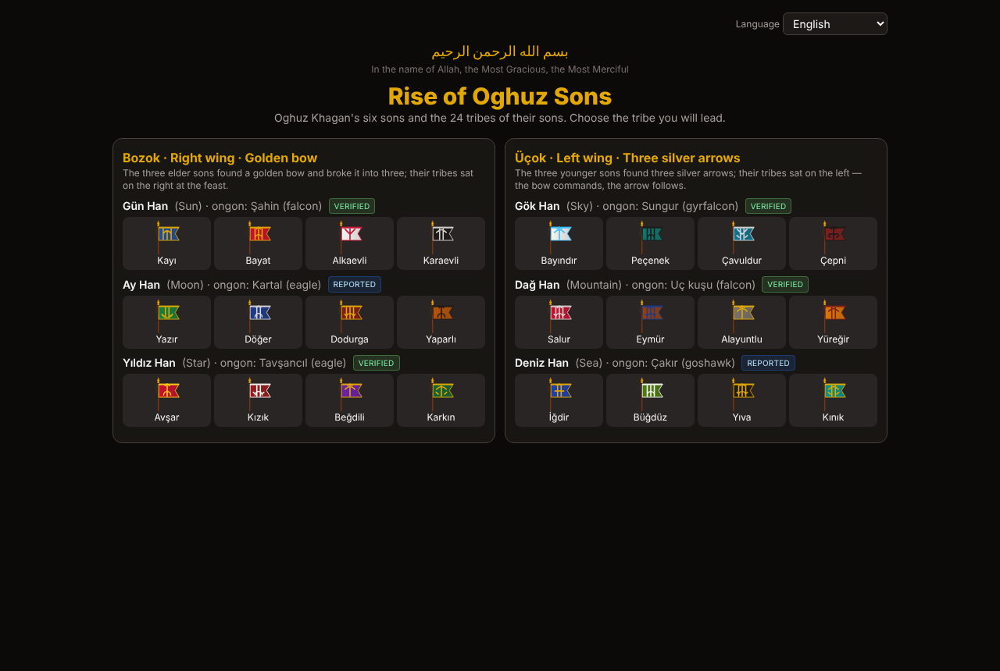
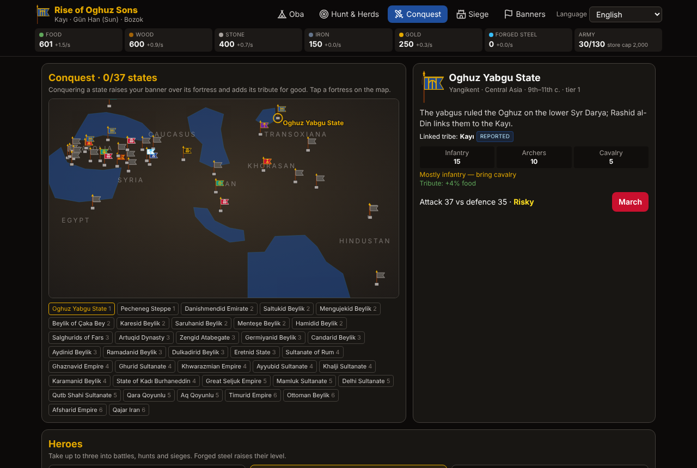
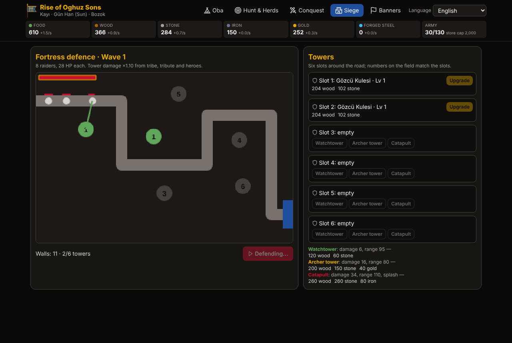

# Rise of Oghuz Sons

**A strategy and conquest game on the 24 Oghuz tribes and the Turkic and Muslim states of history, playable in ten languages.**

Lead one of the 24 tribes descended, in the Oghuz Khagan tradition, from his six sons, build your *oba*, keep your
herds, hunt on the steppe, defend your fortress and unite 37 states and beyliks from Central Asia, Iran and
Anatolia to Egypt and Hindustan, with 22 heroes from Ertuğrul Gazi and Alp Arslan to Salah al-Din and Fatih Sultan
Mehmed.



| Conquest map with tribal banners | Fortress defence |
|---|---|
|  |  |

## Play

- **Online:** after the first push, GitHub Pages publishes the game at
  `https://mhkhan50.github.io/Rise-Of-Oghuz-Sons/` (Settings → Pages → Source: *GitHub Actions*).
- **Locally:**

```bash
npm install
npm run dev      # development server
npm run build    # type-check and production build into dist/
```

Progress is saved in the browser. Resources keep accumulating while the game is closed, for up to eight hours.

## Languages

English, Roman Urdu, Türkçe, Azərbaycanca, Türkmençe, Gagauzca, Oʻzbekcha, Қазақша, العربية and فارسی, with
right-to-left layout for Arabic and Persian. The interface is fully translated in English, Roman Urdu, Turkish,
Azerbaijani, Turkmen, Arabic and Persian; Gagauz, Uzbek and Kazakh cover the main controls and fall back to Turkish
for the rest. Historical notes are written in English, Roman Urdu and Turkish.

To add or complete a language, add a table to `src/i18n/locales.ts` (and its code to `LANGS` in
`src/i18n/strings.ts`). Missing entries fall back automatically, so a translation can grow step by step.

## Gameplay

| Tab | What you do |
|---|---|
| **Oba** | Raise the Otağ, a mosque (Cami), a madrasa (Medrese), a caravanserai (Kervansaray), fields, mines and barracks; train Azap (infantry), Okçu (archers) and Sipahi (cavalry); hold a *toy* (feast) |
| **Hunt & Herds** | Keep sheep, Turkmen warhorses and Bactrian camels; hunt the red stag, wild boar, grey wolves and the Boz Ayı boss |
| **Conquest** | A map of 37 states and beyliks; each fortress flies the banner of its linked tribe, and yours once you take it. Infantry beats archers, archers beat cavalry, cavalry beats infantry (+25%) |
| **Siege** | Tower defence with watchtowers, archer towers and catapults |
| **Banners** | The 24 tribes with their tuğ banners, meanings and dynasties, the chronicle of your campaigns and the sources |

Up to three heroes join your squad; forged steel from the blacksmith raises their level. All characters are shown in
full period dress: kaftan with börk or turban for men, kaftan with headscarf for women.

## History and sources

The tribe list, its order and its grouping under the six sons follow Rashid al-Din's *Jāmiʿ al-Tawārīkh*
(early 14th c.), as reported by Faruk Sümer and the TDV İslâm Ansiklopedisi; Kashgari's *Dīwān Lughāt al-Turk*
(11th c.) lists 22 tribes. Every historical claim in the game is marked:

- **verified**: checked in a reference work (TDV İslâm Ansiklopedisi, Encyclopaedia Iranica, Sümer);
- **reported**: a common account or later tradition, not checked against the primary text;
- **contested**: disputed or not established.

States whose rulers are not recorded as one of the 24 tribes are still on the map but carry no tribe link, and
commanders from outside the 24 tribes appear as allied commanders. Banners are game emblems in the style of steppe
tuğ standards, not reproductions of the historical damgas. Game bonuses and colours are design choices.

## Project structure

```
src/
  i18n/                 languages: interface text, fallback rules, provider
  data/oghuzData.ts     tribes, sons, states with map positions, heroes, buildings, beasts, towers, sources
  engine/               economy (production, costs, offline progress) and combat (counters, heroes, hunting)
  state/useGame.ts      game actions, saving and loading
  components/           tuğ banners, hero portraits, world map, resource bar, tribe selection
  tabs/                 Oba, Hunt & Herds, Conquest, Siege, Banners
```

Built with React, TypeScript, Tailwind CSS and Vite; ready to be packaged for Android and iOS with Capacitor.

## Licence

MIT © 2026 Muzammal Hussain
